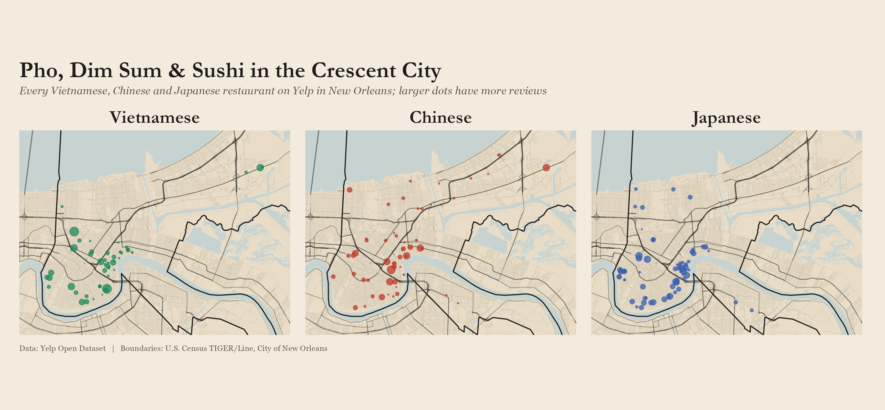
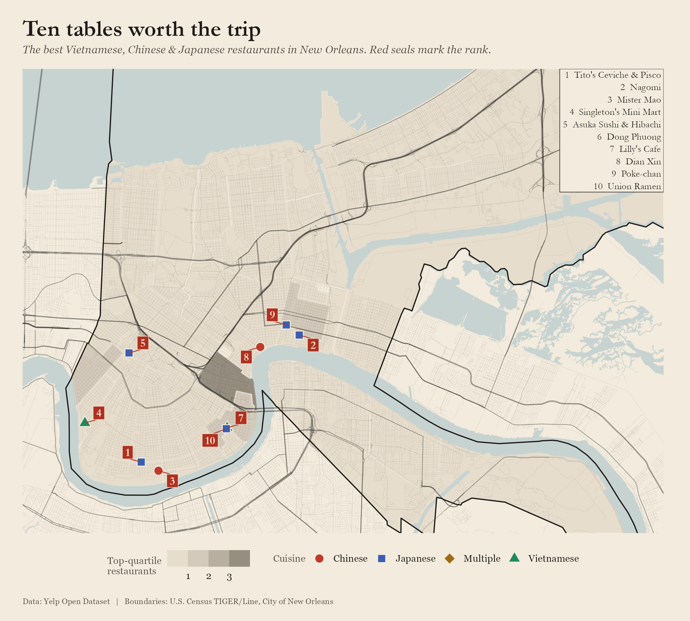
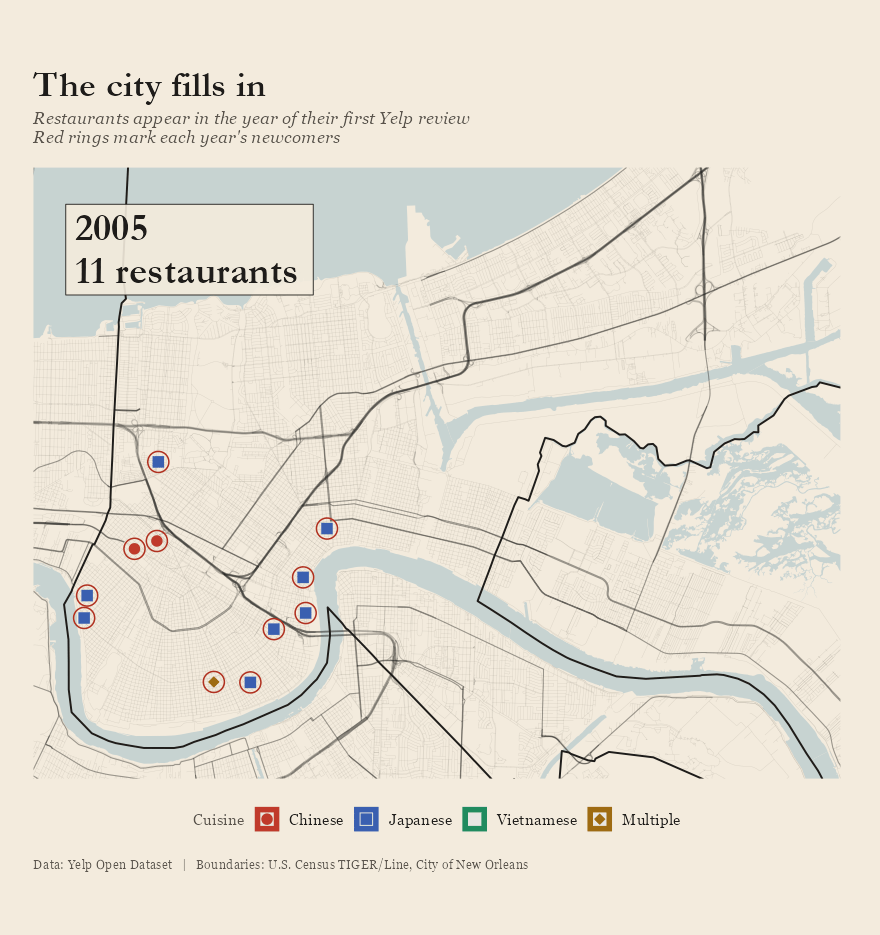

# Pho, Dim Sum & Sushi in the Crescent City
*Where to find the best Vietnamese, Chinese & Japanese food in New Orleans*

**Research question:** Where can someone find the best Vietnamese, Chinese, and Japanese restaurants in New Orleans, and which neighborhood is the best place to look?

## **[▶ Open the full interactive report](https://YOUR-USERNAME.github.io/YOUR-REPO-NAME/)**

*No code needs to be run. The report is a finished web page; this README is a summary of it.*

## Executive summary

The best place to look for Vietnamese, Chinese and Japanese food in New Orleans is the **Central Business District**. It has 4 of the city's 22 top-quartile restaurants in these cuisines, twice as many as any other neighborhood. For a smaller but stronger cluster, St. Claude has two top-ten restaurants among its five. The single best restaurant is **Tito's Ceviche & Pisco** in Uptown, which averages 4.72 stars across 221 reviews. Adjusting for review volume and reviewer habits reshaped the list: Nagomi, the #1 on raw stars (4.96 from only 24 reviews), drops to #2, and only 5 of the final top 10 would make a top ten on raw stars alone.

The study covers every Vietnamese, Chinese and Japanese restaurant on Yelp inside the City of New Orleans (171 restaurants) and all of their reviews; no sampling was used.

## Main findings

1. **For the most choice, go to the Central Business District.** It has 4 of the city's 22 top-quartile restaurants in these cuisines and 30 restaurants in total, more than any other neighborhood. Its overall rating is middling (3.95 stars) and none of its restaurants made the top 10, so it's the best place for a good meal without planning, not for the single best one. For quality over quantity, try **St. Claude**: 2 of its 5 restaurants made the top 10.
2. **Tito's Ceviche & Pisco is the #1 pick, and the top of the list holds up.** It ranks #3 on raw stars and rises to #1 because it pairs a high rating with plenty of reviews (221), and experienced reviewers rated it 0.49 stars above their usual. The raw #1, Nagomi (4.96 stars), drops to #2 because its score rests on only 24 reviews. Popular, well-reviewed places climb the most: Dong Phuong rises from #22 to #6, and Lilly's Cafe from #20 to #7.
3. **The best food is spread out, not concentrated in one district.** The top 10 span 8 neighborhoods, from Uptown and the French Quarter to Village de l'Est in New Orleans East. Japanese restaurants lead with 5 of the 10, alongside 2 Chinese, 2 Vietnamese and one Chinese-Vietnamese restaurant.

*In the [full report](https://YOUR-USERNAME.github.io/YOUR-REPO-NAME/) this map is interactive: hover over a restaurant for a summary, or click it for a full card with its ratings, star breakdown and ranking.*

### Top 10

| Rank | Restaurant | Cuisine | Neighborhood | Avg. stars | Reviews | Rank on raw stars |
|---:|---|---|---|---:|---:|---:|
| 1 | Tito's Ceviche & Pisco | Japanese* | Uptown | 4.72 | 221 | 3 |
| 2 | Nagomi | Japanese | St. Claude | 4.96 | 24 | 1 |
| 3 | Mister Mao | Chinese | West Riverside | 4.66 | 29 | 4 |
| 4 | Singleton's Mini Mart | Vietnamese | Black Pearl | 4.53 | 91 | 8 |
| 5 | Asuka Sushi & Hibachi | Japanese | Gert Town | 4.40 | 316 | 14 |
| 6 | Dong Phuong | Chinese + Vietnamese | Village de l'Est | 4.33 | 423 | 22 |
| 7 | Lilly's Cafe | Vietnamese | Lower Garden District | 4.35 | 797 | 20 |
| 8 | Dian Xin | Chinese | French Quarter | 4.45 | 402 | 12 |
| 9 | Poke-chan | Japanese | St. Claude | 4.52 | 138 | 9 |
| 10 | Union Ramen | Japanese | Lower Garden District | 4.37 | 156 | 18 |

*\*Tito's Ceviche & Pisco is a Peruvian restaurant that serves Nikkei dishes (Peruvian-Japanese cuisine). Yelp lists it under a Japanese category, so it qualifies under the inclusion rule.*

"Rank on raw stars" is where each restaurant would place on its plain Yelp average alone. The final rank also accounts for how many reviews it has and whether experienced reviewers rated it above their own habits.

## Data

- **Yelp Open Dataset**: `yelp_academic_dataset_business.json` and `yelp_academic_dataset_review.json`.
- **U.S. Census TIGER/Line** (through the `tigris` package): the city boundary, 2020 ZCTAs, and 2024 census tracts.
- **City of New Orleans, Neighborhood Statistical Areas** ([data.nola.gov/d/exvn-jeh2](https://data.nola.gov/d/exvn-jeh2)).

**How the large data was handled.** The review file is several gigabytes, too large to load into R at once. [`R/01_import.R`](R/01_import.R) reads it 100,000 lines at a time, keeps only reviews for Louisiana restaurants, drops the review text, and saves compact `.rds` files. The full import took about 2–3 minutes.

**The raw Yelp files are not committed.** They are several gigabytes, which is far over GitHub's file limits, and Yelp's dataset terms do not allow redistributing them. To reproduce the project:

1. Go to <https://business.yelp.com/data/resources/open-dataset/>, accept the terms, and download the JSON dataset.
2. Extract it and put the business and review `.json` files in `data/raw/`.
3. In R, from the project folder, run `renv::restore()` and then `source("R/run_all.R")`.
4. Run `quarto render yelp_new_orleans_project.qmd --output-dir docs` (this writes `docs/index.html`).

## Files

| Path | What it is |
|---|---|
| [`yelp_new_orleans_project.qmd`](yelp_new_orleans_project.qmd) | Report source (reads the saved tables and figures only) |
| [`docs/`](docs/) | Rendered HTML report (published with GitHub Pages) |
| [`R/00_setup.R`](R/00_setup.R) | Packages, paths, and every analysis setting in one place |
| [`R/01_import.R`](R/01_import.R) | Streams the giant JSON in chunks and saves filtered `.rds` files |
| [`R/02_clean_categories.R`](R/02_clean_categories.R) | Cleaning, category counts, co-occurrence, and the inclusion rule |
| [`R/03_geography.R`](R/03_geography.R) | Spatial joins and the comparison of three geographic systems |
| [`R/04_analysis.R`](R/04_analysis.R) | Review join, reviewer normalization, rankings, and figures |
| [`R/05_animations.R`](R/05_animations.R) | Animated GIFs: the city filling in, and reviews growing by cuisine |
| [`output/tables/`](output/tables/) | Every summary table as CSV |
| [`figures/`](figures/) | Every figure (PNG) and animation (GIF) |
| [`R/00_theme.R`](R/00_theme.R) | The "Ink & Lacquer" look: colorblind-checked palette, fonts, ggplot themes, seal-stamp labels |
| [`assets/`](assets/) | Report stylesheet, web fonts and the interactive-map script |
| [`ai_prompts.md`](ai_prompts.md) | AI prompts used and how they were revised |
| `data/raw/` | Raw Yelp JSON, **git-ignored** |

## Design

The figures and report share one visual identity, **Ink & Lacquer**. It uses a rice-paper background, sumi-ink text and gray washes, and one lacquer color per cuisine: cinnabar for Chinese, indigo for Japanese and jade for Vietnamese. The top 10 are marked with red seal stamps, like the chop an artist uses to sign a painting. Every chart is drawn over a faded map of New Orleans, built from the U.S. Census TIGER street, water and city-boundary layers and centered on the French Quarter. The map layers download when you run `R/03_geography.R`. The HTML report also has light motion: the seal stamps onto the title, headings draw their underline, and figures fade in as you scroll. All motion turns off for visitors who have reduced motion enabled on their device. The palette passed a colorblind-safety check, and every chart also uses shapes, so no information depends on color alone. For the full effect, install the free Google Fonts *Cormorant Garamond* and *Noto Serif* before running the scripts.

## Viewing the report

Open the link at the top of this page. The report is a finished web page, so nothing needs to be installed or run. (For the repository owner: it is published with GitHub Pages from Settings → Pages → *Deploy from a branch* → branch `main`, folder `/docs`.)

## AI use

The AI prompts used in this project, including examples of how they were revised, are in [`ai_prompts.md`](ai_prompts.md).
