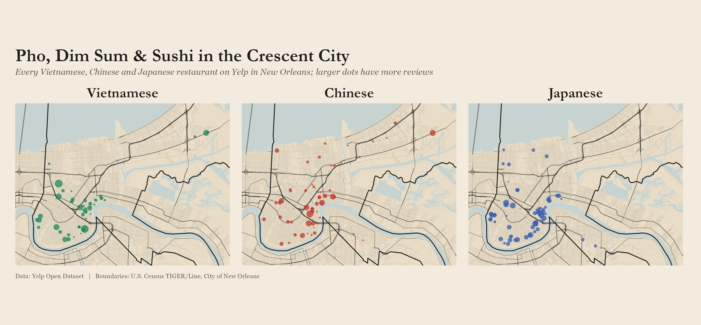
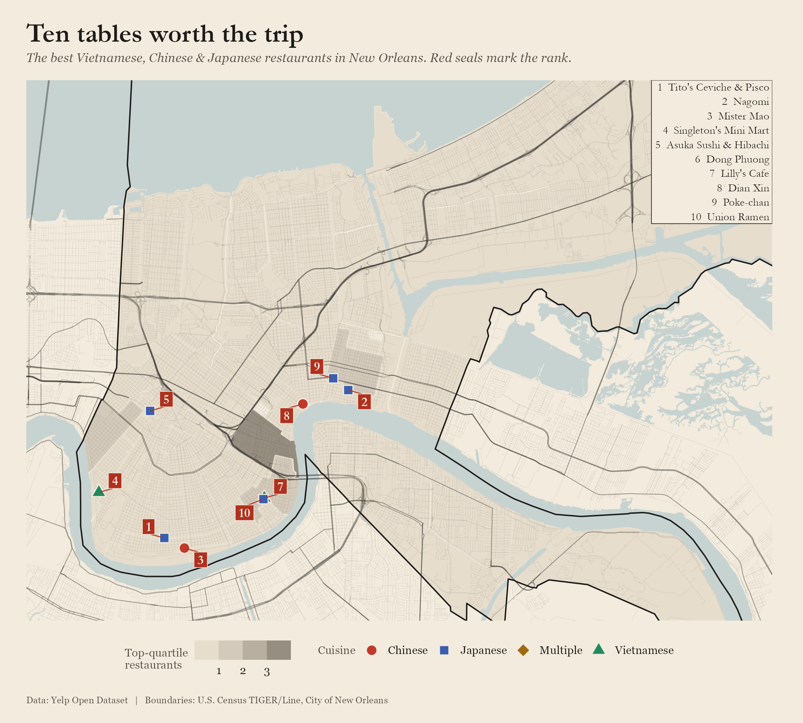
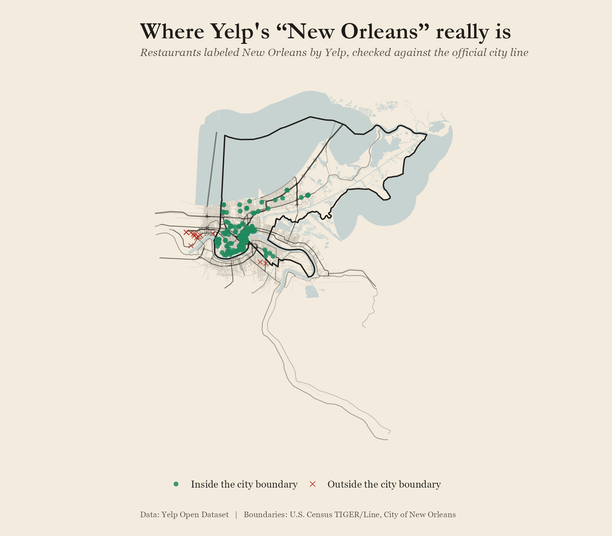
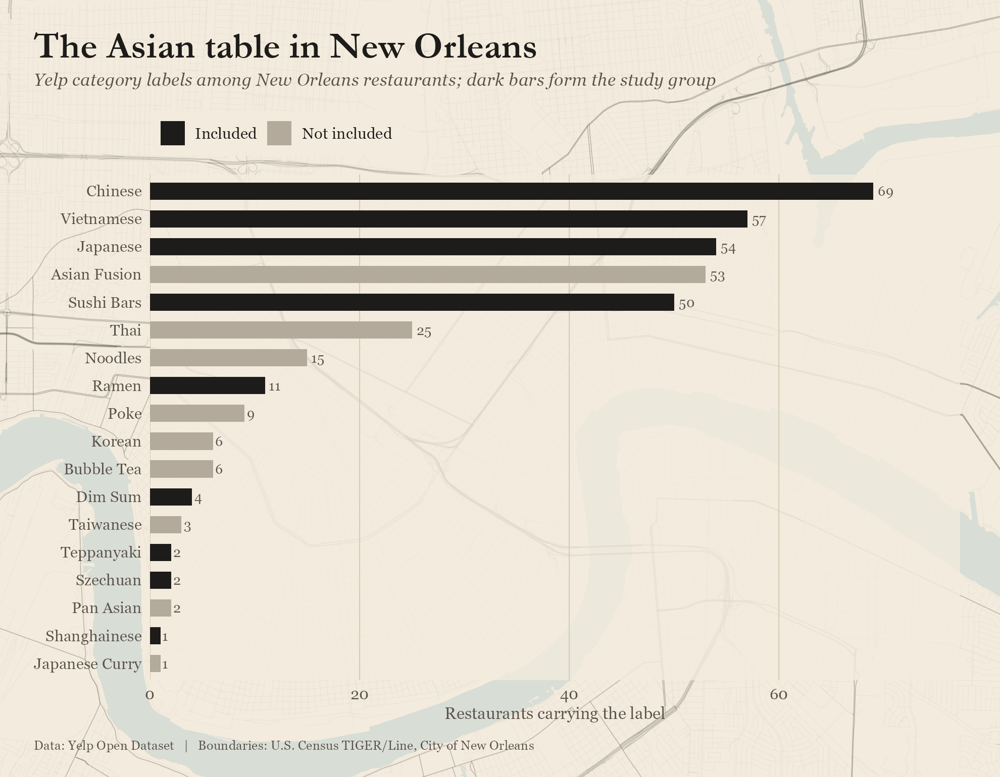
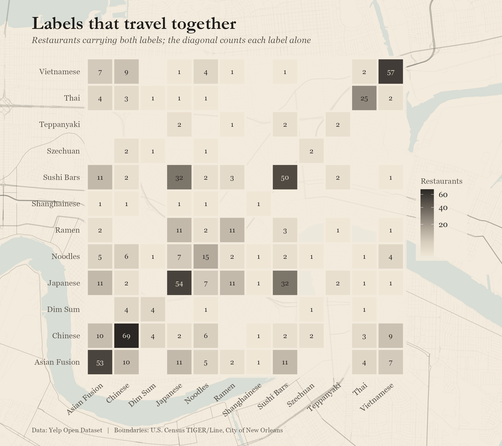
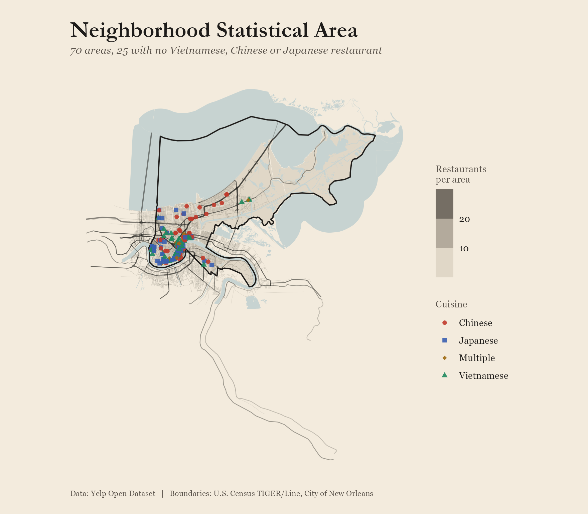
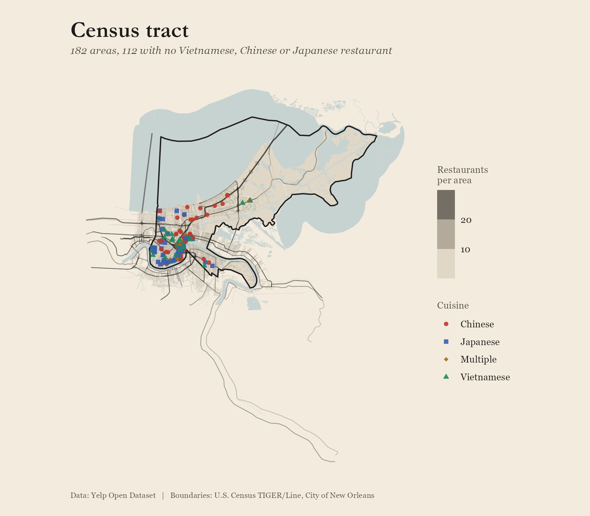
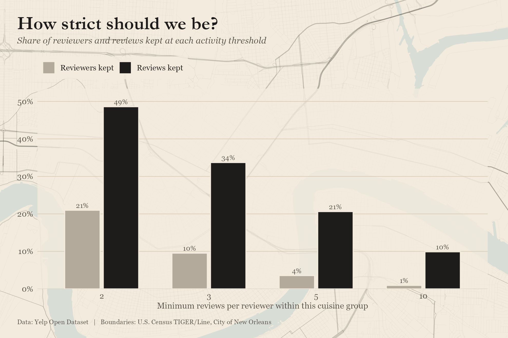
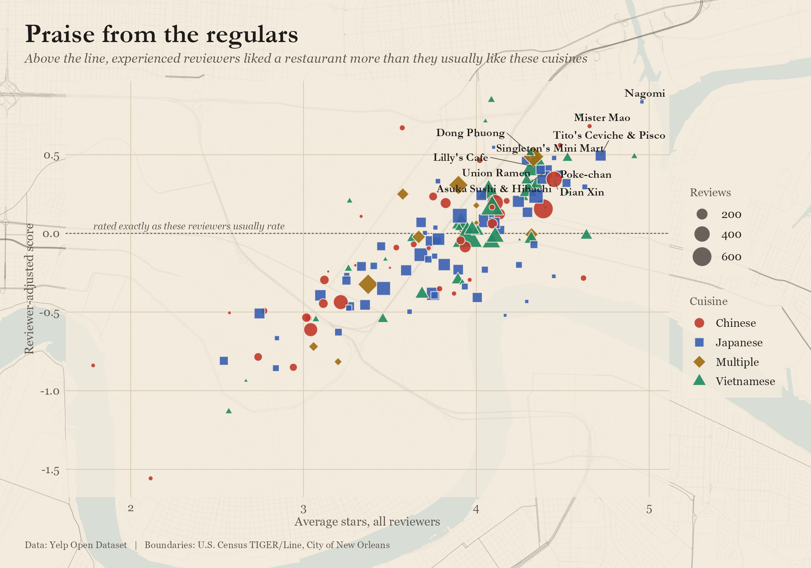
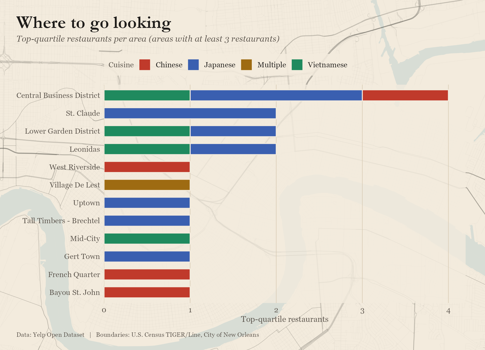

```{r}
#| label: setup
#| include: false
# The report only reads the small tables and figures produced by R/01–04.
# It never touches the raw Yelp JSON, so it renders on any computer.
library(tidyverse)
library(knitr)
if (!file.exists("output/tables/top10_restaurants.csv")) {
  stop("\n\nThe analysis results are missing (output/tables/ is empty).\n",
       "1. Make sure this .qmd sits in the main project folder, next to the R/ folder.\n",
       "2. Run source(\"R/run_all.R\") first. It needs the Yelp JSON files in data/raw/.\n",
       "Current folder: ", getwd(), "\n", call. = FALSE)
}
tbl <- function(name) read_csv(file.path("output/tables", paste0(name, ".csv")), show_col_types = FALSE)
fig <- function(name) file.path("figures", paste0(name, ".png"))
show <- function(x, ...) kable(x, format.args = list(big.mark = ","), digits = 2, ...)

# Animated GIFs are optional (R/05_animations.R). If one has not been built,
# leave it out of the page instead of showing a broken image.
gif <- function(path, caption, alt) {
  if (file.exists(path)) {
    cat(sprintf('{fig-alt="%s"}\n\n', caption, path, alt))
  } else {
    message("Skipping ", path, ": run R/05_animations.R to create it")
  }
}

top10    <- tbl("top10_restaurants")
geo      <- tbl("geography_comparison")
join_chk <- tbl("join_check")
retention <- tbl("reviewer_retention")
```

{fig-alt="Three maps of New Orleans showing every Vietnamese, Chinese and Japanese restaurant, one panel per cuisine"}

## Research question

> **Where can someone find the best Vietnamese, Chinese, and Japanese restaurants in New Orleans, and which neighborhood is the best place to look?**

## Executive summary

The best place to look for Vietnamese, Chinese and Japanese food in New Orleans is the Central Business District. It has 4 of the city’s 22 top-quartile restaurants in these cuisines, twice as many as any other neighborhood. For a smaller but stronger cluster, St. Claude has two top-ten restaurants among its five. The single best restaurant is Tito’s Ceviche & Pisco in Uptown, which averages 4.72 stars across 221 reviews. Adjusting for review volume and reviewer habits reshaped the list: Nagomi, the #1 on raw stars (4.96 from only 24 reviews), drops to #2, and only 5 of the final top 10 would make a top ten on raw stars alone.

The analysis ranks `r format(join_chk$study_restaurants, big.mark = ",")` Vietnamese, Chinese, and Japanese restaurants inside the City of New Orleans and `r format(join_chk$reviews, big.mark = ",")` Yelp reviews.

### The Top 10

```{r}
#| label: top10
#| code-fold: true
top10 |> select(rank, restaurant, cuisine, area, reviews, avg_stars, avg_normalized) |> show()
```

**Hover over a restaurant on the map, or click it (or a name in the list) to open its card.**

```{r}
#| label: interactive-map
#| echo: false
#| results: asis
esc <- htmltools::htmlEscape
has_spots <- all(c("map_left_pct", "map_top_pct") %in% names(top10))
html <- c(
  '<div class="ink-map" id="ink-map">',
  '',
  if (has_spots) sprintf(
    '<button type="button" class="ink-hotspot" data-rank="%d" style="left:%.3f%%;top:%.3f%%" aria-label="Rank %d: %s. Open details"></button>',
    top10$rank, top10$map_left_pct, top10$map_top_pct, top10$rank, esc(top10$restaurant)),
  '<div class="ink-tip" aria-hidden="true"></div>',
  '</div>',
  '<ol class="ink-top10">',
  sprintf(paste0('<li><button type="button" class="ink-top10-item" data-rank="%d">',
                 '<span class="ink-seal">%d</span><span class="ink-name">%s</span>',
                 '<span class="ink-meta">%s &middot; %s &middot; &#9733; %.2f</span></button></li>'),
          top10$rank, top10$rank, esc(top10$restaurant), esc(top10$cuisine),
          esc(top10$area), top10$avg_stars),
  '</ol>',
  paste0('<script>window.INK_TOP10 = ',
         gsub("</", "<\\/", jsonlite::toJSON(top10, dataframe = "rows", na = "null")),
         ';</script>')
)
cat("```{=html}", html, "```", sep = "\n")
```

```{r}
#| label: anim-fill
#| echo: false
#| results: asis
gif("figures/anim_city_fills_in.gif",
    "The city fills in: restaurants appear in the year of their first Yelp review",
    "Animated map of New Orleans where Vietnamese, Chinese and Japanese restaurants appear year by year")
```

## 1. Data and large-data management

```{r}
#| label: import-code
#| eval: false
#| file: R/01_import.R
```

```{r}
#| label: import-log
tbl("import_log") |> show()
```

The Yelp review file is about 5 GB of JSON with nearly 7 million reviews, far too large to load into R in one piece. I first read the much smaller business file and kept only the 3,640 Louisiana restaurants. I then used `jsonlite::stream_in()` to read the review file 100,000 lines at a time, keeping only reviews for those restaurants and dropping the review text, since the analysis uses star ratings, dates and reviewer IDs. The full file was never in memory at once, and the import took about 2–3 minutes on my computer. I saved the filtered data as xz-compressed .rds files in data/new_orleans/, so every later step reads those small files instead of the raw JSON, and no sampling was needed. The raw files are listed in .gitignore, so they never upload to GitHub. Along the way, I fixed a “cannot open file” error caused by R’s working directory not being the project folder, and I moved my project files up one level so the scripts, README and .gitignore sit at the top of the repository.

## 2. Defining a "New Orleans restaurant"

A business is a **restaurant** if its Yelp `categories` contain the word `Restaurants`. It is **in New Orleans** if its coordinates fall inside the official U.S. Census boundary of the City of New Orleans (which is the same as Orleans Parish). Yelp's free-text `city` field was checked against that boundary rather than trusted.

```{r}
#| label: label-check
tbl("label_agreement") |> show()
```



## 3. Choosing the categories

**Why these three belong together:** Vietnamese, Chinese, and Japanese are three of the most common East and Southeast Asian cuisines among New Orleans restaurants on Yelp (see the category counts below), they share dishes and formats (noodle soups, rice and noodle plates, dumplings, seafood), and diners often compare them when choosing “Asian food tonight.” New Orleans also has one of the largest Vietnamese communities in the U.S., which makes the comparison locally meaningful.

```{r}
#| label: cat-code
#| eval: false
#| file: R/02_clean_categories.R
```



```{r}
#| label: pairs
tbl("asian_category_pairs") |> slice_head(n = 12) |> show()
tbl("subcuisine_without_parent") |> show()
```



**Inclusion rule:** a restaurant is included if it has **at least one** of `Vietnamese`, `Chinese`, `Japanese`, or a sub-cuisine label that belongs to one of them (`Sushi Bars`, `Ramen`, `Dim Sum`, `Szechuan`, `Cantonese`, …). The sub-cuisine table above shows how many sushi bars, ramen shops, etc. would be lost if only the parent label were used. `Asian Fusion` by itself is not enough, because it does not say which cuisine is served.

```{r}
#| label: inclusion
tbl("inclusion_summary") |> show()
tbl("requirement_check") |> show()
```

## 4. Joining businesses to reviews

```{r}
#| label: anim-growth
#| echo: false
#| results: asis
gif("figures/anim_reviews_growth.gif",
    "A city learns to review: cumulative reviews by cuisine",
    "Animated line chart of total Yelp reviews over time for Vietnamese, Chinese and Japanese restaurants in New Orleans")
```


```{r}
#| label: join
join_chk |> show()
```

Before any analysis, I used `semi_join()` on `business_id` to keep only the reviews belonging to the study restaurants. This is a one-to-many relationship, where each restaurant can have many reviews, so the filter drops reviews for every unrelated business without duplicating any rows.


## 5. Comparing geographic systems

```{r}
#| label: geo-code
#| eval: false
#| file: R/03_geography.R
```

```{r}
#| label: geo-table
geo |> show()
```

::: {layout-ncol=3}




:::

```{r}
#| label: answer-by-system
tbl("area_answer_by_system") |> show()
```

I chose Neighborhood Statistical Areas for the main analysis. All three systems placed all 171 restaurants in an area, so matching didn’t separate them (one restaurant just outside a ZIP boundary was assigned to the nearest ZIP code, within 100 m); size did. Census tracts are too small. Orleans Parish has 182 tracts, only 70 contain any of these restaurants, and the typical tract that has any has only 1.5. Averages built on one or two restaurants swing widely, and tract averages vary the most of the three systems (a standard deviation of 0.40 stars, against 0.19–0.25 for the others), which mostly reflects noise rather than real differences between areas. ZIP codes are the most statistically stable, with a median of 6 restaurants each and 14 of 18 ZIP codes large enough to rank. But at a median of 13.7 km² each, they are about five to six times the size of a neighborhood and mix very different parts of the city, so they are too broad to tell a visitor where to go. Neighborhoods fall between the two. At a median of 2.4 km² they are small enough to explore, they carry names people actually use, such as the French Quarter and Mid-City, and 18 of the 70 have the three or more restaurants needed for a fair comparison. The trade-off is that these restaurants are concentrated: 25 neighborhoods have none at all, the typical neighborhood that has any has only 2, and the busiest has 30. The neighborhood ranking therefore compares 18 neighborhoods where these restaurants cluster; it is not a verdict on every part of the city.

## 6. All reviewers vs. selected reviewers

```{r}
#| label: analysis-code
#| eval: false
#| file: R/04_analysis.R
```

**Eligible reviewers** wrote at least 5 reviews within this cuisine group. Each review's **normalized score** is the reviewer's stars minus that reviewer's own average for the group. A positive score means the reviewer liked that restaurant *more than they usually like* Vietnamese, Chinese, or Japanese restaurants. This is not a new Yelp rating. The mean baseline is the main one because stars are whole numbers, so a median baseline turns most scores into exactly 0.

```{r}
#| label: retention
retention |> mutate(across(starts_with("pct"), scales::percent)) |> show()
tbl("threshold_sensitivity") |> show()
```





```{r}
#| label: movers
tbl("rank_changes") |> slice_head(n = 10) |> show()
```

The adjustment matters most for restaurants with very few or very many reviews. Nagomi is the clearest example of a small sample. Its 4.96 stars put it #1 on raw stars, but they come from only 24 reviews, so the reliability adjustment pulls it toward the average and it finishes #2. The biggest climbs go the other way, to popular restaurants with hundreds of reviews and experienced reviewers who rated them above their usual standard. Dong Phuong (423 reviews) rises from #22 on raw stars to #6, Lilly’s Cafe (797 reviews) from #20 to #7, Union Ramen from #18 to #10, and Asuka Sushi & Hibachi (316 reviews) from #14 to #5. A raw average of about 4.3–4.4 stars looks ordinary, but backed by hundreds of reviews, with experienced reviewers rating these places above their own average, it is stronger evidence than a near-perfect score from a handful. Yelp does not record whether a reviewer is a tourist or a local, so these shifts show differences between experienced and one-time reviewers, not between visitors and residents.

### How "best" is defined

A restaurant is ranked only if it is still open, has at least 20 reviews, and has at least 3 reviews from eligible reviewers. Two scores are adjusted for reliability by adding 10 "average" pseudo-reviews, so a 5.0 from 4 reviews cannot beat a 4.7 from 400:

1. **raw stars** (what diners see), and
2. **reviewer-normalized score** (did experienced reviewers like it more than usual?).

The final **best score** is the average of the two percentile ranks.

## 7. Which area is best?

```{r}
#| label: areas
tbl(paste0("area_summary_", "nsa")) |>
  filter(rankable_area) |>
  select(area_name, restaurants, reviews, review_weighted_stars,
         mean_normalized, top_quartile_restaurants, top10_restaurants) |>
  slice_head(n = 10) |> show()
```



## Conclusions

1. For the most choice, go to the Central Business District. It has 4 of the city’s 22 top-quartile Vietnamese, Chinese and Japanese restaurants, twice as many as any other neighborhood, and 30 restaurants in total, far more than anywhere else. Its overall rating is middling (3.95 stars, weighted by reviews) because it also has many ordinary places, and none of its restaurants made the top 10. It’s the best place to find a good meal without planning, but not the place for the single best one. If you care about quality over quantity, St. Claude stands out: 2 of its 5 restaurants are top-quartile, both made the top 10 (Nagomi and Poke-chan), and its review-weighted rating is 4.24 stars.

2. Tito’s Ceviche & Pisco in Uptown is the #1 pick, and the top of the list holds up after adjustment. It averages 4.72 stars across 221 reviews, and experienced reviewers rated it 0.49 stars above their usual. On raw stars it ranks #3. The raw #1, Nagomi, has 4.96 stars but drops to #2 because that score rests on only 24 reviews. Further down, the adjustment matters more: only 5 of the 10 would make a top ten on raw stars alone. Popular, well-reviewed favorites rise: Dong Phuong (423 reviews) climbs from #22 to #6, and Lilly’s Cafe (797 reviews) from #20 to #7. The method trusts a 4.3-star average from hundreds of reviews more than a near-perfect score from a handful.

3. The best food is spread out, not concentrated in one district. The top 10 are spread across 8 neighborhoods, from Uptown and the French Quarter to Village de l’Est in New Orleans East. Only St. Claude and the Lower Garden District have two each. Japanese restaurants lead the list with 5 of the 10, alongside 2 Chinese, 2 Vietnamese and one Chinese-Vietnamese restaurant (Dong Phuong). This is also why the choice of boundaries matters: large ZIP codes would lump these scattered restaurants together, while most of the city’s 182 census tracts hold only one or two of them. Neighborhoods are the scale at which the pattern is visible.

*NOTE: Yelp tags Tito’s as Japanese, reflecting its Nikkei-style dishes, so it qualifies under the inclusion rule

## Limitations

- The Yelp Open Dataset is a **snapshot** (reviews end in `r format(as.Date(join_chk$last_review), "%B %Y")`). Restaurants may have opened, closed, or changed since then.
- The strongest Vietnamese food scene in the metro area is partly in **Gretna, Marrero, and the West Bank**, which are outside the city boundary and therefore excluded.
- Yelp reviewers are not a random sample of diners, and Yelp does not record whether a reviewer is a tourist or a local, so the ratings may lean toward visitors in tourist-heavy areas.
- Only some reviewers write 5 or more reviews in this cuisine group (see the retention table in section 6), so the adjusted score rests on a smaller group of experienced reviewers.
- Restaurants are included based on Yelp’s own category labels, which are sometimes loose; Tito’s Ceviche & Pisco, for example, qualifies through a Japanese label.

## AI use

See [`ai_prompts.md`](ai_prompts.md) for the prompts used and how they were revised.

## Reproducibility

Packages are recorded in `renv.lock`. To reproduce: download the Yelp data into `data/raw/`, then run `source("R/run_all.R")`, then `quarto render yelp_new_orleans_project.qmd --output-dir docs`.
